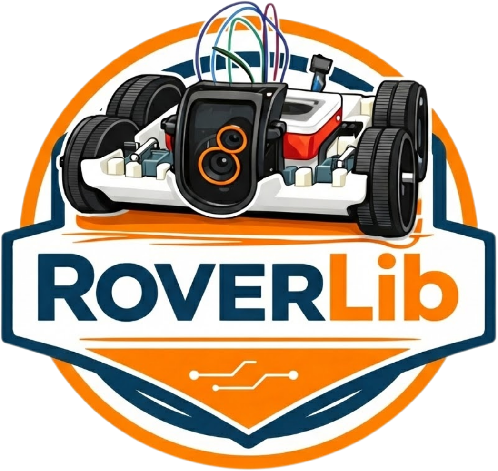

# RoverLib

<p align="center">

</p>

Biblioteca Python educacional para programar o **Rover**, robô do Projeto ROVER (*Robotic Optical Vehicle for Embedded Recognition*) do Departamento de Computação da UFPI, baseado em **Raspberry Pi 5**.

A RoverLib transforma o controle das rodas, a captura de imagens e a leitura de sensores em comandos simples, para que o foco das aulas fique nos conceitos de robótica, visão computacional e IA.

📖 **Documentação:** https://rover-project.github.io/Rover/

```python
from roverlib import Rover

with Rover.from_config("config.yaml") as rover:
    rover.move.forward(speed=50, duration=2)       # anda 2 segundos
    frame = rover.camera.get_frame()               # captura uma imagem
    if rover.lidar.is_obstacle(30):                # algo a menos de 30 cm?
        rover.move.stop()
```

## Destaques

- **Mesmo código no PC e no Rover:** sem a Raspberry Pi, os motores são simulados e a câmera usa a webcam.
- **Configuração em `config.yaml`:** pinos, calibração, câmera e Lidar fora do código.
- **CLI para projetos:** `rover new` cria um projeto com exemplos; `rover run` o executa.
- **Visão computacional:** segmentação por cor e detecção de círculos e linhas com OpenCV.
- **Sensores:** Lidar TF-Luna com `get_distance()` e `is_obstacle()`.

## Início rápido

```bash
pip install roverlib[cli]
rover new meu_projeto
cd meu_projeto
rover run
```

No PC, a saída mostra os motores simulados. Na Raspberry Pi, o mesmo projeto move o Rover. Para testar na Raspberry Pi sem mover as rodas: `ROVER_SIMULATE=1 rover run`.

Instalação na Raspberry Pi (câmera, GPIO, UART): veja o guia de [Instalação](docs/instalacao.md) ou use o script `rover_setup.sh`.

## Hardware

| Componente | Modelo |
|---|---|
| Computador | Raspberry Pi 5 |
| Motores | 2 motores DC com ponte-H L298N |
| Câmera | Picamera2 (Camera Module 3 para foco automático) |
| Distância | Lidar TF-Luna (UART) |
| Servos | PCA9685 (I²C) ou GPIO |

## Estrutura do repositório

```
Rover/
├── roverlib/            # a biblioteca (pacote Python publicado no PyPI)
│   └── src/roverlib/
│       ├── rover.py     # classe Rover (ponto de entrada)
│       ├── modules/     # movimento (Robot, PID), visão e processamento de imagem
│       ├── plugins/     # drivers: motor, câmera, Lidar, servos, GPIO (pin)
│       ├── cli/         # comando `rover` e template do `rover new`
│       └── utils/       # Config
├── examples/            # projetos completos (seguir linha, seguir bola, Lidar, YOLO...)
├── docs/                # documentação (MkDocs)
├── mkdocs.yml
└── rover_setup.sh       # setup da Raspberry Pi
```

## Documentação

- [Instalação](docs/instalacao.md)
- [Primeiro projeto](docs/primeiro-projeto.md): tutorial sem precisar do robô
- [Configuração (`config.yaml`)](docs/configuracao.md)
- [Exemplos](docs/exemplos.md)
- [Arquitetura](docs/arquitetura.md)
- [Referência da API](https://rover-project.github.io/Rover/api/rover/) (gerada a partir do código)

Para ver a documentação localmente:

```bash
pip install mkdocs-material "mkdocstrings[python]"
mkdocs serve
```

## Desenvolvimento

```bash
cd roverlib
pip install -e .[cli,dev]
python -m pytest src/roverlib --ignore=src/roverlib/plugins/pin --ignore=src/roverlib/plugins/PCAServos
```

Os testes rodam sem hardware. Os de `pin` e `PCAServos` exigem a Raspberry Pi.

## Licença

[MIT](roverlib/LICENSE). Contribuições são bem-vindas: abra uma *issue* ou um *pull request*.
