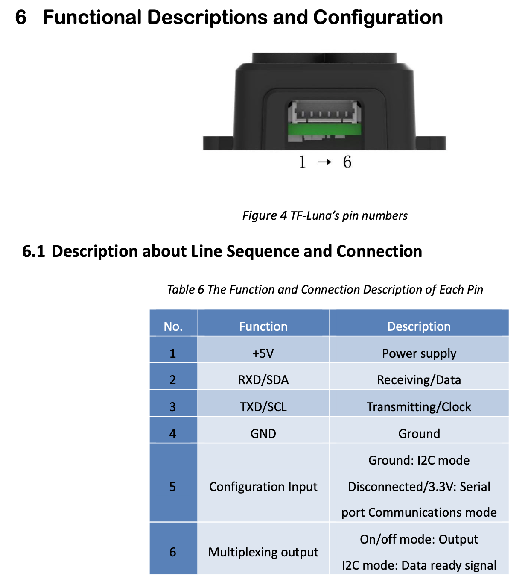

# Plugin Lidar (TF-Luna)

Sensor de distância de um ponto (0,2 m a 8 m) via UART. Pelo `Rover`, é acessado como `rover.lidar`.

## Estrutura

```
lidar/
├── __init__.py      # API pública
├── lidar.py         # Lidar: driver real (pySerial)
├── virtual.py       # VirtualLidar: versão simulada
├── exceptions.py    # LidarNotStart, LidarDoNotRespond, LidarNotAvailable
└── tests/
```

## Documentação Técnica

### 1. Especificações de Operação

O sensor TF-Luna opera utilizando o protocolo UART. Para a prosperidade, as especificações de configuração são:

- **Baud Rate**: 115200 bps

- **Frequência de Saída**: 100 Hz (Padrão do TF-Luna)

- **Estrutura de pacotes**: 9 bytes por leitura.
  - **_Bytes 0 e 1_**: Cabeçalho (0x59 0x59 (Tem que ser esse))

  - **_Bytes 2 e 3_**: Distância em **cm**

  - **_Bytes 4 e 5_**: Força do sinal

  - **_Bytes 6 e 7_**: Temperatura do chip (°C)

  - **_Byte 8_**: Checksum (método de verificação de erros ou "Impressão digital" dos dados)

### 2. Uso rápido (API da RoverLib)

O TF-Luna mede a distância de **um único ponto** à frente do sensor (0,2 m a 8 m).

```python
from roverlib.plugins.lidar.lidar import Lidar

with Lidar() as lidar:               # start() e stop() automáticos
    print(lidar.get_distance())      # distância em cm (ou None se inválida)
    print(lidar.get_distance("m"))   # também aceita "m" e "mm"

    if lidar.is_obstacle(30):        # obstáculo a 30 cm ou menos?
        print("Pare!")

    dist, forca, temp = lidar.get_read()  # leitura bruta completa
```

| Função | Descrição |
|---|---|
| `start()` / `stop()` | Abre a porta e inicia a leitura em segundo plano / encerra tudo |
| `get_distance(unit="cm")` | Distância em `cm`, `m` ou `mm`; `None` se não houver leitura ou se o sinal for fraco (< 100) ou saturado (65535) |
| `is_obstacle(limit_cm=30)` | `True` se houver leitura válida menor ou igual ao limite |
| `get_read()` | Tupla `(distância_cm, força, temperatura_C)`; `(-1, -1, -1)` antes da 1ª leitura |
| `change_config(**settings)` | Altera configurações da porta (ex.: `timeout=2`) e retorna as atuais |
| `get_reads_until(n)` | Lê `n` bytes brutos (uso avançado/depuração) |

Quadros com **checksum inválido são descartados**, e o Lidar é desligado automaticamente se o chip passar de 65 °C.

### 3. Pinout do Lidar:



Com o lidar nessa posição, da direita pra esquerda, 1 -> 6.

- 1. VCC: Qualquer de 5V
- 2. RX/SDA: Pino 8 (GPIO 14)
- 3. TX/SCL: Pino 10 (GPIO 15)
- 4. GND: Qualquer ground
- 5. Input de configuração: Ground == I2C mode / 3.3V Serial mode
- 6. Multiplexing output.

### 4. Biblioteca usada (pySerial)

Para comunicação entre Raspberry Pi 5 e o TF-Luna dos dados lidos pelo Lidar, foi utilizada a biblioteca pySerial.

`pip install pyserial`

> Atenção: o pacote `serial` do PyPI é **outro** projeto e não funciona aqui. O correto é `pyserial` (importado como `import serial`).

A baixo, teremos as funções utilizadas no script de teste:

- `serial.Serial(port..., baudrate..., timeout...)`: É o construtor. Inicializa a porta física e define as regras de comunicação
  - `Port= '/dev/ttyAMA0'`: Especifica o arquivo de dispositivo que representa os pinos GPIO 14 e 15.

  - `baudrate=115200`: Define a velocidade de sinalização. Ambos os dispositivos devem operar na mesma frequência.

  - `timeout=1`: Define o tempo máximo de espera (em segundos) por um dado antes de retornar None. Isso evita que o script trave no caso de uma remoção de sensor, por exemplo.

- `uart_lidar.in_waiting()`
  - **Função**: Retorna o número de bytes já armazenado no buffer.

  - **Uso no script**: Utilizamos para verificar se há pelo menos 9 bytes (um pacote inteiro) antes de iniciar a leitura dos datos.

- `uart_lidar.read(size)`

  **Função:** Realiza a leitura física.

  **Observação**: É uma estrutura FIFO. Ao fazer .read(1), retiramos o dado mais antigo da fila.

- `uart_lidar.reset_input_buffer()`
  - **Função**: Descarta todos os dados do buffer de input.

  - **Uso no projeto**: Foi usado para "manter o tempo real", eliminando os dados que foram adquiridos, mas ficaram obsoletos pois não foram usados.

- `uart_lidar.write(data)`
  - **Função**: Envia uma sequênca de bytes através do pino TX (GPIO 14)

  - **Observação**: Pode ser usado para definir configurações no TF-Luna, enviando pacotes específicos de acordo com o manual.

- `uart_lidar.close()`
  - **Função**: Encerra corretamente a conexão de hardware, liberando a porta /dev/ttyAMA0

  - **Observação**: Sempre incluir em bloco com um KeyboardInterrupt ou semelhante.

### 5. Problemas com o Buffer Serial (Overflow):

Durante o desenvolvimento do script de testes, foi encontrado um problema crítico no seu uso: **_A velocidade elevada de leitura contra a velocidade de processamento_**

**Análise do problema**:

1. O Lidar envia 900 bytes por segundo (ou 100 Hz \* 9 bytes).

2. Certas libs ou funcionalidades que formos usar esses dados como o Matplotlib podem gerar atraso na renderização ou tratamento desses dados, fazendo com que se acumulem no buffer.

Em resumo, se lermos apenas 9 bytes enquanto o Lidar envia 100, muitas coisas ficaram no passado, atrasando o retorno do Script.

**Solução com gestão de Fluxo (in_wainting)**:

`if uart_lidar.in_waiting > 500:`

Garante que se a quantidade de dados que estiverem esperando forem maior que 500 bytes (valor sugerido), é possível limpar, ou armazenar esses dados sobressalentes, resolvendo o problema de overflow.

### 6. Simulação

O `VirtualLidar` tem a mesma interface do `Lidar` e informa a distância que você definir:

```python
from roverlib.plugins.lidar import VirtualLidar

with VirtualLidar(distance=200) as lidar:
    lidar.is_obstacle(30)     # False
    lidar.set_distance(20)    # simula um obstáculo a 20 cm
    lidar.is_obstacle(30)     # True
```

O `rover.lidar` usa o `VirtualLidar` automaticamente quando o `pyserial` ou a porta serial não estão disponíveis (PC), com `simulate: true` na seção `lidar:` ou com `ROVER_SIMULATE=1`. A distância inicial vem de `simulated_distance` (padrão 200 cm).

### 7. Exceções

Todas herdam de `RoverLibError`:

| Exceção | Quando | Também é um |
|---|---|---|
| `LidarNotStart` | a porta serial não abre | `RuntimeError` |
| `LidarDoNotRespond` | o sensor não envia dados | `RuntimeError` |
| `LidarNotAvailable` | `pyserial` não instalado | `ModuleNotFoundError` |

### 8. Testes

```bash
python -m pytest src/roverlib/plugins/lidar
```

Os testes rodam no PC, sem hardware. O `Lidar` é testado com uma porta serial simulada que envia quadros do TF-Luna.
